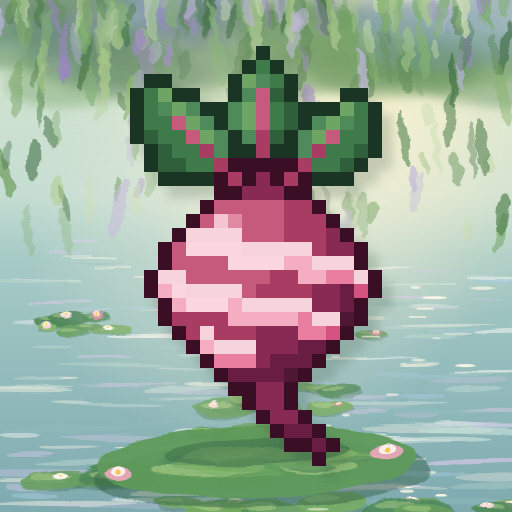
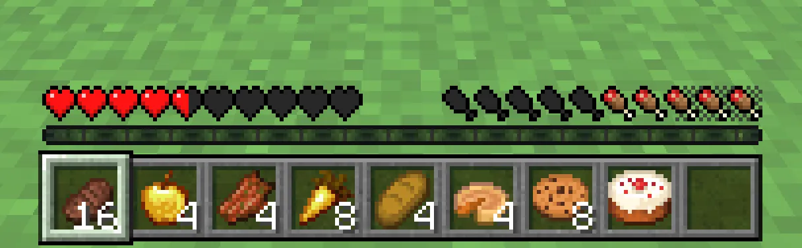
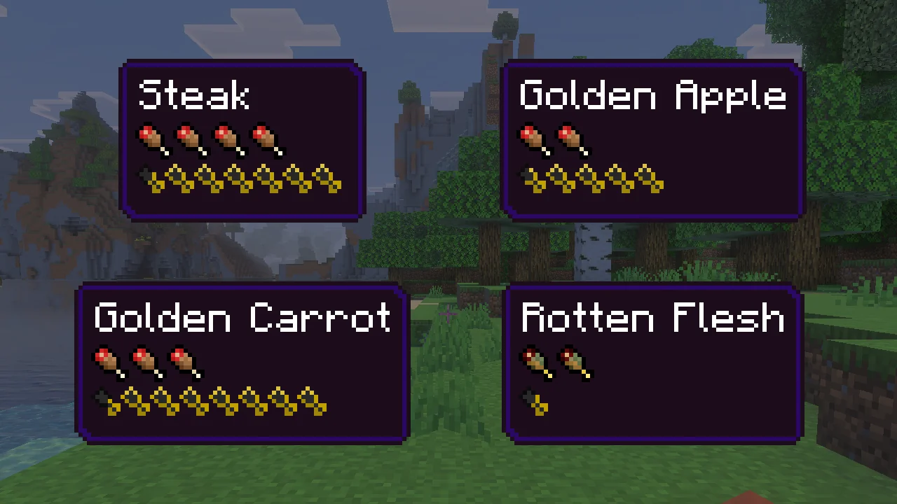

# BeetrootSkin



English | [简体中文](README.zh-CN.md)

[](https://github.com/LiteLDev/BeetrootSkin/releases)
[](COPYING.LESSER)

Know exactly what your food is worth. BeetrootSkin brings [AppleSkin](https://github.com/squeek502/AppleSkin), the much-loved Java Edition mod, to Minecraft Bedrock: food values in tooltips, a preview of what eating will restore, and the hidden saturation and exhaustion made visible on your HUD.

<p align="center"></p>

## Features

- **Food values in tooltips.** Hover any food to see the shanks and saturation it gives. Rotten flesh, raw chicken and other risky foods get the green "bad food" icons.
- **See what a bite will do.** Hold food and the hunger bar flashes the shanks and saturation it would add; the hearts flash the health you would get back, golden apples included.
- **Saturation you can see.** Golden outlines over your shanks show how much saturation is left before hunger starts to drop.
- **Exhaustion you can see.** A checkered strip behind the shanks grows as you sprint, jump and fight; when it is full, the next bit of saturation or hunger is used.
- **Exact numbers on demand.** Press `F6` for a line with your precise hunger, saturation and exhaustion.

<p align="center"></p>

Works in single-player, in LAN worlds and on servers. Only you need it: nothing is installed on the server.

## Install

You need Minecraft Bedrock Edition **1.26.51** for Windows (x64) with LeviLamina **26.51.x**, for example set up with [LeviLauncher](https://github.com/LiteLDev/LeviLauncher).

With [lip](https://github.com/LiteLDev/lip):

```sh
lip install github.com/LiteLDev/BeetrootSkin#client
```

Or download `beetrootskin-client-windows-x64.zip` from the [latest release](https://github.com/LiteLDev/BeetrootSkin/releases/latest) and unzip it so that `BeetrootSkin/` lands in the game's `mods/` folder.

## How to use

Nothing to set up: start a survival or adventure world.

| To see | Do this |
| --- | --- |
| What a food restores | Hover it in any inventory or chest |
| What eating it would do right now | Hold it (main hand or offhand) |
| Your saturation and exhaustion | Just look at the hunger bar |
| Exact hunger, saturation and exhaustion | Press `F6` (remap it in *Settings → Keyboard & Mouse*) |

## Settings

Everything is on by default. To change it, edit `mods/BeetrootSkin/config/config.json`; changes apply within a second, even while you play. The names are AppleSkin's.

| Option | Default | What it does |
| --- | --- | --- |
| `showFoodValuesInTooltipAlways` | `true` | Set to `false` to show food values only while you hold `Shift`. |
| `showFoodValuesInTooltip` | `true` | Food values in tooltips while `Shift` is held. |
| `showFoodValuesHudOverlay` | `true` | Flash the hunger and saturation the held food would restore. |
| `showFoodValuesHudOverlayWhenOffhand` | `true` | Also preview food in your offhand. |
| `showFoodHealthHudOverlay` | `true` | Flash the health the held food would restore. |
| `showSaturationHudOverlay` | `true` | Golden saturation outlines on the hunger bar. |
| `showFoodExhaustionHudUnderlay` | `true` | The exhaustion strip behind the shanks. |
| `showVanillaAnimationsOverlay` | `true` | Let the overlays shake along with the hunger bar. |
| `maxHudOverlayFlashAlpha` | `0.65` | How strong the flashing previews get, from `0` to `1`. |
| `showFoodDebugInfo` | `false` | The exact-numbers line (what `F6` toggles). |

Bedrock heals differently from Java (a steady regeneration while hunger is 18 or more), so the health preview follows Bedrock's rules and can differ from AppleSkin on Java.

## More

More screenshots and videos: https://levimc.org/mods/github.com/LiteLDev/BeetrootSkin/?tab=gallery

Building it yourself or writing a mod against it? See [CONTRIBUTING.md](CONTRIBUTING.md).

## License

[LGPL-3.0-or-later](COPYING.LESSER) © LeviMC. The HUD and tooltip icons are AppleSkin's, by squeek502, released under the Unlicense ([NOTICE](assets/textures/NOTICE)). Not affiliated with Mojang Studios, Microsoft or the AppleSkin project.
